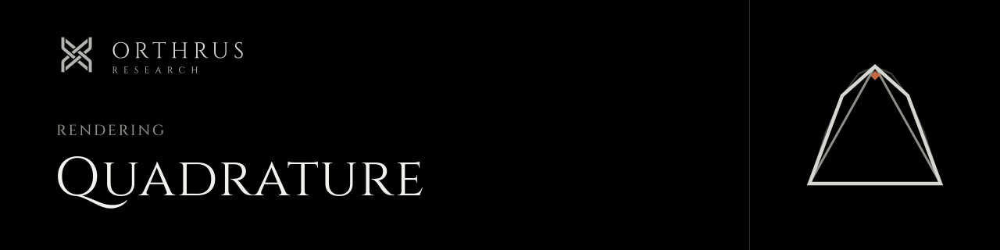

<p align="center"></p>

<p align="center">
<a href="#status"></a>
<a href="LICENSE"></a>
<a href="https://discord.gg/qCVqhXtSzR"></a>
</p>

Quadrature is a rendering pipeline for Minecraft 1.12.2 cubic worlds on
[Cleanroom](https://github.com/CleanroomMC/Cleanroom) with
[Cubature](https://github.com/orthrus-research/Cubature). It draws the whole frame.

## Status

In development: Phases 0 to 3 are closed and Phase 4, distant terrain replacing Distant
Horizons, is in progress. By default the mod checks the platform, stops with a message where it is not
supported, draws near terrain meshed from Cubature's cube source in the whole frame's reversed
depth, and times each stage of the frame on the CPU and the GPU; `-Dquadrature.terrain=game`
leaves terrain to the game. Behind switches, off by default, it draws distant terrain sampled
from the client terrain preview (`-Dquadrature.distant=own`) and a shading stage handed over in
a folder (`-Dquadrature.stage=true`). [PLAN.md](docs/PLAN.md) gives each phase's status.

## What Quadrature draws

- **Near terrain:** meshed directly from cubes.
- **Distant terrain:** as levels of detail.
- **Entities and block entities:** hosted from the game's own renderers.
- **Lighting and post-processing:** through its own shaders.

It is a new implementation. It contains no code from other renderers, shader loaders or
level-of-detail mods.

## For players and pack makers

| | |
|---|---|
| World | Cubic worlds (Cubature) |
| Loader | Cleanroom, Java 26 |
| Graphics API | OpenGL 4.6, compatibility profile |
| GPU | NVIDIA, Turing generation (RTX 20 series) or later, with at least 8 GB of memory |
| Driver | NVIDIA R580 branch or later; a warning below the current production branch |
| Other renderers | None installed; the game stops with a message if one is found |

These requirements are narrow on purpose. The design keeps each of them behind a named seam
so support can widen later without rewriting what sits above it; see
[the design frame](docs/REQUIREMENTS.md#design-frame).

## Building from source

The build reads the set: [orthrus-set](https://github.com/orthrus-research/orthrus-set)'s `set.json` names the
platform (the JDK, Cleanroom, CleanroomGradle) and the Cubature and OrthLib files it compiles against, by SHA-256.
In a Workbench worktree the folder's `.set` says which revision, and `./gradlew build` just works. In a plain
clone, clone the Set beside it and pass it:

```sh
./gradlew build -Pset.dir=../orthrus-set -Pset.with.cubature=../Cubature -Pset.with.orthlib=../OrthLib
```

(`python ../orthrus-set/tools/checkout.py` checks the siblings out at the set's commits; a plain-clone build is a
development build, its bytes not checked against the set). Run Gradle on the JDK the set's platform names
(Temurin 26.0.2.1+1).

Workbench runs the checks from a clean clone, `wb check` in a worktree: the build with every module's tests, the
offline Mixin check, shader validation and the tool tests ([project.toml](project.toml);
[VERIFICATION.md](docs/VERIFICATION.md#checks) says what each checks). `./gradlew validateShaders` compiles every GLSL stage the mod holds with glslang
(`glslangValidator` on the path) without a game.

`./gradlew runClient` starts a development client. Adding `-PdevWorld=<seconds>` enters a
flat development world unattended, logs each stage's CPU and GPU time every five seconds,
and quits after that many seconds. Adding `-PstateAudit` also reads OpenGL state at every
stage boundary and reports what each stage leaves changed. The whole frame uses reversed depth
unless `-Dquadrature.reversedDepth=false` (`-PconventionalDepth` in the development client, which
leaves terrain to the game, having no Cubature); `-PdepthSelfTest` checks the projection
translations against the driver. `-Pprobe=offscreen` or `-Pprobe=visible` runs a
development stage of Quadrature's own inside the world pass.

Own terrain needs a cubic world, so it runs in an instance with Cubature, not in the development
client; without Cubature the game stops at loading with a message, unless started with
`-Dquadrature.terrain=game`. The build takes Cubature's API, and the bridge to OrthLib's render
interface takes OrthLib, from the files the set names, re-hashed before any compile (`setVerify`); instances are
prepared with the same files. A new Cubature or OrthLib reaches Quadrature by landing in the Set, with no commit
here. Adding `-PtestMemoryFloorMiB=<n>`
raises the GPU memory floor for that run, to see the stop screen on a supported card; the
property can only raise the floor.

[graphics.json](graphics.json) is Quadrature's own graphics floor (the API, the vendor, the driver branches). The
root module is the Minecraft host; `core` has
no Minecraft dependency.

## Documentation

- [docs/DECISIONS.md](docs/DECISIONS.md): standing decisions and their reasons
- [docs/ARCHITECTURE.md](docs/ARCHITECTURE.md): how the pipeline is put together, and which
  choices are decided, default or still candidates
- [docs/API.md](docs/API.md): each technique's switches, entry points, inputs and outputs,
  threads, measured costs, and where its design is recorded
- [docs/PLAN.md](docs/PLAN.md): phases, what closes each one, and the first work orders
- [docs/REQUIREMENTS.md](docs/REQUIREMENTS.md): what each part of the pipeline must do, and
  the questions a research pass has to answer before implementation

- [docs/VERIFICATION.md](docs/VERIFICATION.md): how frames are captured and compared, and
  the measured repeatability
- [docs/BASELINE.md](docs/BASELINE.md): what the current stack measures, as the bar to meet
- [docs/research/](docs/research/README.md): research findings per work order, with the
  basis of each and what is still open

- [docs/CUBE-SOURCE.md](docs/CUBE-SOURCE.md): what Quadrature relies on from Cubature's cube
  source contract
- [docs/PROVENANCE.md](docs/PROVENANCE.md): where each technique came from, and the rules
  for what may be used

## Community

Questions and discussion: [Discord](https://discord.gg/qCVqhXtSzR). Bugs and requests: this repository's issues. Security
and private matters: admin@orthrus.cc. Pull requests are welcome; see
[CONTRIBUTING.md](https://github.com/orthrus-research/.github/blob/main/CONTRIBUTING.md).

## License

Original Quadrature material is licensed under the [Apache License 2.0](LICENSE). Material
offered up to 2026-11-17 was offered under NRR 1.0, a public-domain dedication, and keeps
that grant. [NOTICE.md](NOTICE.md) lists what is covered separately.

## Related projects

- [Cubature](https://github.com/orthrus-research/Cubature): cubic world storage, delivery and
  lighting; supplies cubes to Quadrature
- [Riven](https://github.com/orthrus-research/Riven): terrain generation; supplies distant terrain
  without building cubes
- [OrthLib](https://orthrus.cc/projects/orthlib): shared library; carries the interface other mods
  use to reach Quadrature

---

<sub>Quadrature is an [Orthrus Research](https://orthrus.cc) project ·
[All projects](https://orthrus.cc/projects) · [Texts](https://orthrus.cc/texts) ·
[Discord](https://discord.gg/qCVqhXtSzR)</sub>
